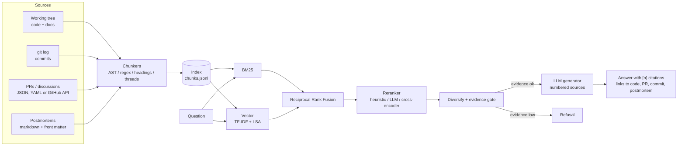

# GitContext

**Your codebase, answered.** A retrieval-augmented developer copilot that answers questions about a
repository from its code *and* its history: commits, pull requests, review discussions, docs and
incident postmortems, with every sentence linked back to the source it came from.

[](pyproject.toml)
[](LICENSE)
[](.github/workflows/ci.yml)
[](https://github.com/astral-sh/ruff)

## Why this exists

Code search tells you *what* a function does. The questions engineers actually ask are usually *why*:
why do we refresh tokens 60 seconds early, why is there a lock here, what broke last time someone
changed this? Those answers live in PR threads, commit messages and postmortems that no file-level
search will surface. GitContext indexes all of them together, retrieves across them with a hybrid
lexical + vector search, and generates answers that cite the exact code lines, PR, commit or
postmortem they rely on. When the evidence isn't there, it says so instead of guessing.

## Key features

- **Multi-source ingestion**: working-tree files, `git log` history (author, date, files changed,
  PR references), markdown docs, and PRs / discussions / incident reports from a JSON/YAML/markdown
  export or the GitHub REST API (optional connector, token from `GITHUB_TOKEN`).
- **Structure-aware chunking**: Python split along the AST (functions, classes, methods with their
  class signature as context, a module chunk for constants); declaration-boundary regex for
  TS/JS/Go/Rust/Ruby; docs by heading with breadcrumbs; one chunk per commit; PR threads split into
  description and review discussion. Every chunk carries path, symbol, line range, author, PR
  number, commit sha, last-updated date and a deep link.
- **Hybrid retrieval**: Okapi BM25 over a code-aware tokenizer (`refreshAccessToken` matches
  "refresh access token") + dense vectors (word and char n-gram TF-IDF projected with LSA, local and
  deterministic), fused with **Reciprocal Rank Fusion**.
- **Reranking**: a transparent cross-feature reranker (IDF-weighted coverage, title/symbol match,
  bigram match, query-intent source priors, explicit `#134` / file references). LLM and
  cross-encoder rerankers plug into the same protocol.
- **Grounded generation**: numbered sources in the prompt, inline `[n]` citations renumbered and
  validated against what was retrieved, MMR-style source-type diversification so an answer can
  combine code, the PR that explains it and the postmortem that motivated it.
- **Refusal**: an IDF-weighted evidence score gates generation; the model can also return
  `INSUFFICIENT_EVIDENCE`; answers with no valid citation are rejected.
- **Interfaces**: `ask-repo` CLI, FastAPI (`POST /ask`, `GET /search`, `POST /index`), and a Slack
  bot adapter (Socket Mode, `slack_bolt` optional extra).
- **Evaluation**: 25 questions with gold sources + 5 unanswerable ones; Recall@5 / MRR / nDCG for
  BM25 vs vector vs hybrid vs hybrid+rerank, plus citation precision and refusal accuracy.

## Architecture



1. **Connectors** turn a repository into `Document`s (file, commit, PR, discussion, incident).
2. **Chunkers** split each document along its natural structure and attach citation metadata.
3. The **retriever** runs BM25 and vector search independently, fuses the two rankings with RRF
   and reranks the top 30 candidates with features that look at the question and chunk together.
4. The **context builder** picks the top 6 chunks (max 2 per document, penalising repeated source
   types) and computes an evidence score; below the threshold the question is refused.
5. The **generator** prompts the configured LLM with numbered `<source>` blocks; citations in the
   output are validated, renumbered and resolved to links.

Deep dive, sequence diagrams, data model and ADRs: [docs/ARCHITECTURE.md](docs/ARCHITECTURE.md).

## Quickstart

```bash
git clone https://github.com/Navyagowda2714/gitcontext && cd gitcontext
python -m venv .venv && source .venv/bin/activate
make install          # pip install -e ".[dev]"
make demo             # builds the sample repo with real git history, indexes it, asks 4 questions
make eval             # retrieval ablation + answer metrics -> evals/results.json
```

The demo and tests run fully offline. Without an API key, generation uses `OfflineProvider`, a
**deterministic extractive stand-in**: it selects the best-matching sentence from each retrieved
source and stitches them together with citations. It never invents text, but it does not
synthesise either, so answer-quality numbers in this README are a floor; real quality numbers
require a real model.

**Use a real LLM**

```bash
pip install -e ".[anthropic]"
export LLM_PROVIDER=anthropic ANTHROPIC_API_KEY=sk-ant-...   # LLM_MODEL defaults to claude-sonnet-5-5
ask-repo index path/to/your/repo --repo-url https://github.com/you/your-repo
ask-repo ask "Why do we retry webhooks?"
```

`LLM_PROVIDER=openai` (`gpt-4o-mini` default) and `LLM_PROVIDER=ollama` (`llama3.1` on
`localhost:11434`) work the same way. A missing key falls back to offline mode with a logged warning.

**Docker**

```bash
docker build -t gitcontext .
docker run -p 8000:8000 gitcontext          # indexes the bundled sample repo, serves the API
```

## Usage

### CLI

```text
$ ask-repo index .cache/shopfront-api --index-dir .cache/index
Indexed 95 chunks into .cache/index
  documents: code=11, commit=15, discussion=2, doc=5, incident=3, pr=4
  chunks:    code=43, commit=15, discussion=4, doc=15, incident=10, pr=8

$ ask-repo ask "How does token refresh work?" --index-dir .cache/index
`SessionManager.refresh_if_needed` (`shopfront/auth/session.py:L51-L66`): Refresh the token pair
when it expires within the skew window [1]. The postmortem INC-2026-014: Token refresh storm logged
out 18% of active users notes: The identity provider's token endpoint received roughly 40x its
normal traffic [2]. Authentication > Token refresh (docs/auth.md:L9-L23): Server-side callers use
`SessionManager.get_access_token()`, which refreshes the access token proactively once it is within
60 seconds (plus up to 15 seconds of random jitter) of expiry [3]. PR #134: Refresh access tokens
proactively with skew buffer and single-flight lock by priya-raman: Follow-up to INC-2026-014
(token refresh storm) [4].

Sources:
  [1] code       shopfront/auth/session.py:L51-L66        SessionManager.refresh_if_needed
      https://github.com/shopfront/shopfront-api/blob/de5608d.../shopfront/auth/session.py#L51-L66
  [2] incident   .gitcontext/incidents/2026-03-14-token-refresh-storm.md:L1-L8 INC-2026-014: ...
      https://github.com/shopfront/shopfront-api/blob/HEAD/.gitcontext/incidents/2026-03-14-token-refresh-storm.md#L1
  [3] doc        docs/auth.md:L9-L23                      Authentication > Token refresh
      https://github.com/shopfront/shopfront-api/blob/de5608d.../docs/auth.md#L9
  [4] pr         PR #134                                  PR #134: Refresh access tokens proactively ...
      https://github.com/shopfront/shopfront-api/pull/134

model=offline-extractive evidence=1.00 latency=10ms tokens_in=1594 tokens_out=177

$ ask-repo ask "How do we configure Kubernetes horizontal pod autoscaling?"
I couldn't find enough evidence in the indexed code, history, PRs, docs or postmortems to answer
that confidently.

(refused: evidence score 0.10 below threshold 0.35; evidence=0.10)

$ ask-repo search "single-flight refresh lock" -k 3
 1.  0.8068  pr         PR #134                                  PR #134: Refresh access tokens proactively ...
 2.  0.7833  commit     e9ba9e9                                  fix(auth): refresh tokens proactively ...
 3.  0.7773  pr         PR #134                                  PR #134: Refresh access tokens proactively ...
```

(Output from the offline demo in this repo; long URLs abbreviated.) History questions work too:
*"Who changed the session manager to refresh tokens proactively, and when?"* is answered from
commit `e9ba9e9` *by Priya Raman on 2026-03-20* plus PR #134.

### HTTP API

```bash
make serve   # indexes the sample repo, then uvicorn on :8000
curl -s localhost:8000/ask -H 'content-type: application/json' \
     -d '{"question": "Why did customers receive duplicate invoices?"}'
```

`POST /ask` returns `answer`, `citations[]` (`index`, `doc_id`, `source_type`, `location`, `url`,
`snippet`), `refused`, `refusal_reason`, `evidence_score`, `model`, `latency_ms`. `GET /search?q=`
returns ranked chunks; `POST /index {"path": ...}` re-indexes.

### Python

```python
from pathlib import Path
from gitcontext import GitContext
from gitcontext.config import Settings

engine = GitContext.build(Path("path/to/repo"), settings=Settings(index_dir=Path(".idx")))
answer = engine.ask("Why didn't we use a distributed Redis lock for token refresh?")
print(answer.answer)
for c in answer.citations:
    print(c.index, c.source_type.value, c.location, c.url)
```

### Slack

```bash
pip install -e ".[slack]"
export SLACK_BOT_TOKEN=xoxb-... SLACK_APP_TOKEN=xapp-...
python -m gitcontext.interfaces.slack_bot     # @gitcontext <question> or /ask-repo <question>
```

Citations render as Slack links; sources are listed in a context block.

### Bringing PRs and postmortems

Drop exports next to the repo (or pass `--fixtures DIR`):

```text
.gitcontext/
  prs/134.json                 # number, title, author, body, merged_at, files, comments[]
  discussions/27.yaml          # number, title, body, comments[]
  incidents/2026-03-14-x.md    # YAML front matter: id, title, severity, date, related_prs
```

or fetch PRs with `GitHubConnector(owner, repo).fetch_pull_requests()`.

## Evaluation

`make eval` builds the sample repo (15 commits, 4 PRs, 2 discussions, 3 postmortems, 11 code
files, 5 docs; 95 chunks) and runs 30 questions: 25 with hand-labelled gold sources and 5 the index
cannot answer. Metrics are document-level (chunks collapsed to their parent document). Numbers below
are from the last run in this environment with the offline generator.

| Retrieval mode | Recall@5 | MRR@10 | nDCG@5 | Hit@1 | p50 latency (ms) |
|---|---|---|---|---|---|
| BM25 only | 0.973 | 0.820 | 0.847 | 0.680 | 0.2 |
| Vector only (TF-IDF + LSA) | 0.950 | 0.827 | 0.836 | 0.680 | 1.7 |
| Hybrid (RRF) | 0.960 | 0.847 | 0.858 | 0.720 | 2.0 |
| **Hybrid + rerank** | **0.973** | **0.913** | **0.890** | **0.840** | 7.4 |

| Answer metric (hybrid + rerank, offline extractive generator) | Value |
|---|---|
| Citation precision (cited docs that are gold) | 0.637 |
| Gold-source coverage of citations | 0.767 |
| Answered / answerable | 25 / 25 |
| Refusal accuracy on unanswerable questions | 0.800 (4 / 5) |

Takeaways: on a small corpus almost every method finds the gold documents somewhere in the top 5;
the difference is *ordering*. Fusion helps a little, and the reranker moves the right source to
rank 1 in 84% of questions (vs 68% for either retriever alone). A leave-one-feature-out ablation
(also in `make eval`) shows IDF coverage and the query-intent prior carry the gain, while the title
match feature actually hurts on this set (Hit@1 0.92 without it). Citation precision is limited by the
extractive stand-in, which cites any source with an on-topic sentence; it is also a lower bound
because the gold lists are deliberately minimal. The one missed refusal ("rotate the Postgres
encryption keys") shares enough vocabulary with the corpus to pass the lexical evidence gate; see
[docs/EVALUATION.md](docs/EVALUATION.md) for per-question results and failure analysis.

## Design decisions & trade-offs

- **Lexical + local vectors by default.** Code questions are full of identifiers where BM25 is very
  strong; the TF-IDF/LSA embedder adds fuzzy and co-occurrence matching with zero downloads and
  deterministic results. `make_embedder("st:<model>")` swaps in sentence-transformers.
- **RRF instead of score blending.** BM25 and cosine scores live on different scales; rank fusion
  needs no calibration and is robust when one retriever returns nothing.
- **A transparent heuristic reranker first.** Every feature is inspectable in `scores` (`rr_*`),
  which makes failures debuggable; an LLM or cross-encoder reranker is a constructor argument away.
- **Refuse on evidence, not on vibes.** The IDF-weighted coverage gate is cheap and catches
  out-of-vocabulary questions before any tokens are spent; the prompt-level refusal handles the
  subtler cases when a real model is configured.
- **Index = JSONL of chunks.** Retrievers rebuild in well under a second for repos of this size,
  which avoids pickling sklearn objects and keeps the index diffable. Large monorepos need a real
  vector store (see roadmap).
- **Fixtures as a first-class connector.** Many teams keep postmortems outside GitHub; a plain
  file format makes the system usable without API tokens and makes evaluation reproducible.

## Project structure

```text
gitcontext/
├── src/gitcontext/
│   ├── ingest/          # git_repo.py (files + git log), fixtures.py (PR/discussion/incident), github_api.py
│   ├── chunking/        # code.py (AST + regex), markdown.py, thread/commit chunking
│   ├── retrieval/       # text.py tokenizer, bm25.py, embeddings.py, hybrid.py (RRF), rerank.py
│   ├── answer/          # prompts.py, generator.py (citations, refusal)
│   ├── llm/             # LLMClient protocol; Anthropic, OpenAI, Ollama, Offline providers
│   ├── eval/            # metrics.py, runner.py
│   ├── interfaces/      # render.py, slack_bot.py
│   ├── engine.py        # GitContext facade: build / load / search / ask
│   ├── api.py           # FastAPI app
│   ├── cli.py           # ask-repo
│   └── samples.py       # replays examples/sample_history.yaml into a real git repo
├── examples/
│   ├── sample_repo/     # "shopfront-api": auth, billing, rate limiting + .gitcontext exports
│   ├── sample_history.yaml
│   ├── demo.py
│   └── api_example.py
├── evals/questions.yaml # 30 questions with gold sources
├── tests/               # 37 tests, offline
└── docs/                # ARCHITECTURE.md, EVALUATION.md
```

## Roadmap

- Persist embeddings in a vector store (pgvector / LanceDB) and index incrementally from
  `git log <last-indexed-sha>..HEAD` instead of rebuilding.
- Tree-sitter chunking for non-Python languages instead of the regex fallback.
- Run the eval with Claude as generator and an LLM judge for answer faithfulness; report it next to
  the offline floor.
- Calibrate the refusal threshold on a larger unanswerable set (the current gate is lexical).
- Blame-aware answers ("who last touched these lines") via `git blame` on cited ranges.

## License

MIT, see [LICENSE](LICENSE).

Built by [Navyashree Byregowda](https://www.linkedin.com/in/navyashree-byregowda-472821196/)
