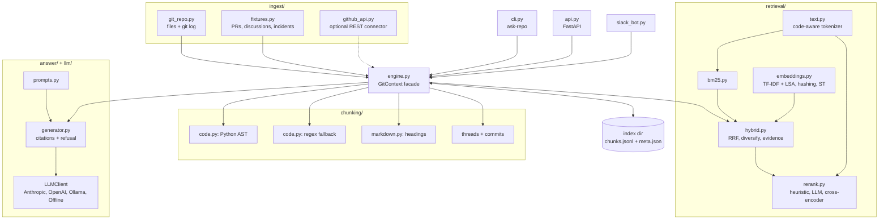
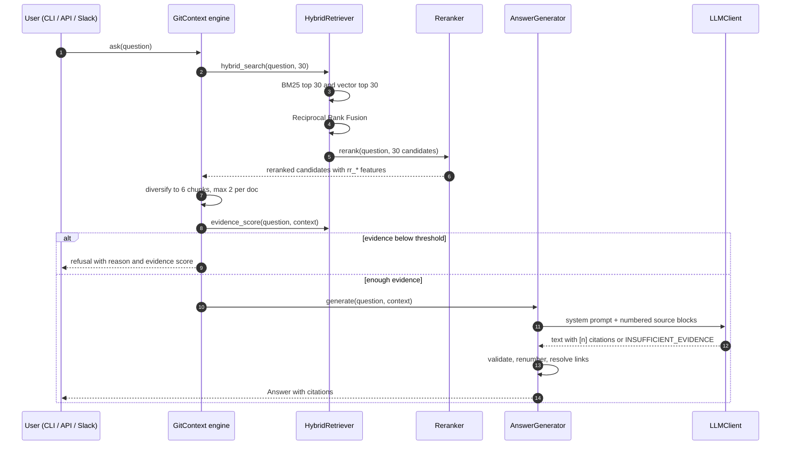
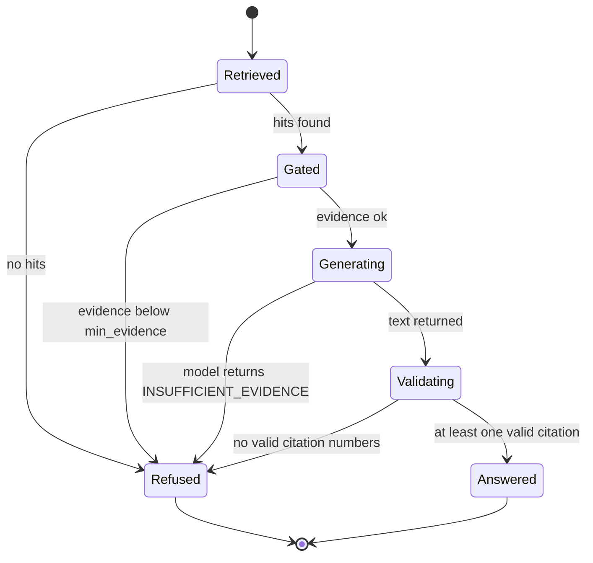
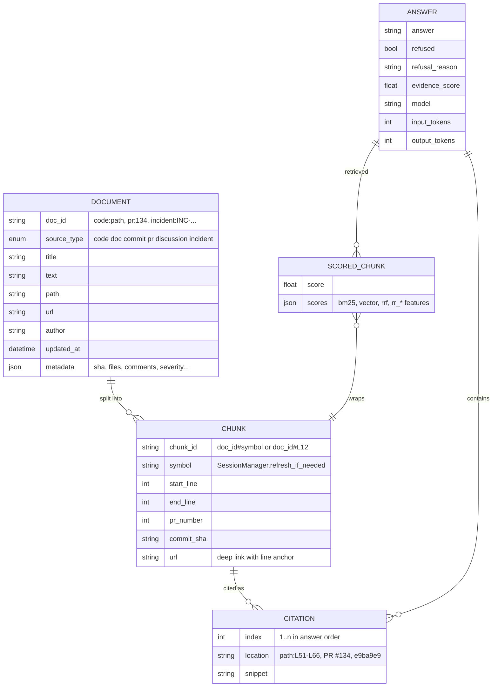

# GitContext architecture

## Overview

GitContext answers natural-language questions about a software repository using evidence from six
source types: code, documentation, commits, pull requests, discussions and incident postmortems. It
is a classic two-phase RAG system:

- **Offline (index time)**: connectors read the repository and its collaboration artefacts,
  chunkers split them along their natural structure, and the chunks are persisted as JSONL.
- **Online (query time)**: a hybrid retriever (BM25 + vectors, Reciprocal Rank Fusion), a
  reranker, a context selector with an evidence gate, and an LLM generator that must cite numbered
  sources.

Everything runs locally with no network by default; LLM providers, the GitHub API, Slack and neural
embedders are optional extras loaded lazily.

## Components

| Component | Responsibility | Key decisions |
|---|---|---|
| `ingest.git_repo` | Walk the working tree, read `git log --numstat`, map each file to its last commit | One `git log --name-only` call builds the last-touch map instead of one call per file |
| `ingest.fixtures` | Load PRs / discussions (JSON or YAML) and postmortems (markdown + front matter) | Pydantic schemas validate exports; same `PullRequest` model as the GitHub connector |
| `chunking.code` | Python: functions, classes (methods split if the class exceeds 40 lines), module constants. Others: declaration regex, window fallback | Methods carry the class signature as a prefix so they are retrievable by class name |
| `chunking.markdown` | Heading sections with breadcrumbs, fence-aware, tiny sections merged, huge ones split on paragraphs | Breadcrumb titles (`Auth > Token refresh`) feed the contextual header |
| `retrieval.text` | Tokenizer: camelCase / snake_case splitting, stopwords, light stemming | Shared by BM25, reranker and evidence scoring so they agree on what a "term" is |
| `retrieval.hybrid` | BM25 + vector search, RRF (k=60), diversification, evidence score | Rank fusion avoids calibrating BM25 against cosine |
| `retrieval.rerank` | Cross-features over (query, chunk) pairs | Features exposed in `ScoredChunk.scores` for debugging |
| `answer.generator` | Prompting, citation validation and renumbering, refusal | Uncited answers are rejected rather than shown |
| `llm` | Provider protocol and factory, offline extractive stand-in | SDK imports are lazy; missing keys fall back to offline with a warning |

## Request lifecycle

Latency on the sample corpus (95 chunks): BM25 ~0.2 ms, vector ~1.7 ms, full hybrid + rerank
~7 ms per query (median, from `make eval`). With a hosted LLM the generation call dominates.

### Answer gating

## Data model

On disk the index is `chunks.jsonl` (one `Chunk` per line) plus `meta.json` (source counts, build
time, repo path). Retrievers are rebuilt from chunks on load.

## Design decisions (ADR style)

### ADR-1: Hybrid retrieval with Reciprocal Rank Fusion

- **Context**: Code questions mix exact identifiers (`invalid_grant`, `REFRESH_SKEW_SECONDS`) with
  paraphrased intent ("why do tokens get refreshed early"). Lexical search handles the first,
  vectors the second; their raw scores are not comparable.
- **Decision**: Run both, fuse ranks with RRF (`1 / (60 + rank)`), rerank the fused top 30.
- **Consequences**: No score calibration, graceful when one side returns nothing. The ablation
  shows fusion alone is a small gain on this corpus; most of the ordering gain comes from the
  reranker (Hit@1 0.72 to 0.84).

### ADR-2: Local TF-IDF + LSA embedder as the default

- **Context**: The project must run (and be evaluated) with no model downloads.
- **Decision**: Word-level (code-aware tokenizer, uni+bigrams) and character 3-5-gram TF-IDF,
  projected to 192 dimensions with truncated SVD when the corpus is large enough.
- **Consequences**: Deterministic, fast, decent fuzzy matching; weaker than neural embeddings on
  true paraphrase. The `Embedder` protocol makes sentence-transformers a one-line swap.

### ADR-3: Heuristic reranker before neural rerankers

- **Context**: A cross-encoder or LLM judge is the usual second stage, but it needs a model and
  makes failures opaque.
- **Decision**: Default to a linear combination of interpretable features (IDF coverage, title
  match, bigrams, fused score, intent prior, explicit references); keep `LLMReranker` and
  `CrossEncoderReranker` behind the same `Reranker` protocol.
- **Consequences**: Weights are hand-set and were not tuned on the eval set, but other pieces
  (context diversification, the offline answerer) were adjusted while inspecting eval failures, so
  the eval is effectively a development set. A learned reranker is on the roadmap.

### ADR-4: Evidence-gated generation and strict citation validation

- **Context**: Hallucinated answers about a codebase are worse than no answer.
- **Decision**: Refuse before calling the LLM when IDF-weighted query coverage of the context is
  below `min_evidence` (0.35). After generation, keep only citation numbers that refer to provided
  sources; refuse when none remain.
- **Consequences**: Cheap and strict; the lexical gate can be fooled by questions that reuse corpus
  vocabulary for an unrelated topic (1 of 5 unanswerable questions in the eval).

### ADR-5: Source-type-aware context selection

- **Context**: Top-k by score often returns four slices of the same file, starving the generator of
  the PR or postmortem that explains it.
- **Decision**: Greedy MMR-style selection: at most 2 chunks per document and a small penalty
  (0.03) for each already-selected chunk of the same source type.
- **Consequences**: For "How does token refresh work?" the context now includes the code, PR #134,
  the postmortem and the docs, instead of three code chunks.

### ADR-6: File-based fixtures for collaboration data

- **Context**: PRs and postmortems often live in different systems; API access needs tokens.
- **Decision**: A documented JSON/YAML/markdown export format, with the GitHub connector producing
  the same `Document` shape.
- **Consequences**: Reproducible tests and evaluation; teams can script exports from Jira,
  Confluence or incident tools without touching GitContext.

## Failure modes & mitigations

| Failure mode | Effect | Mitigation |
|---|---|---|
| Question uses corpus words for an unrelated topic | Evidence gate passes, weak answer | Prompt-level `INSUFFICIENT_EVIDENCE`, citation validation; roadmap: calibrated gate |
| LLM cites a number that was not provided | Broken link | Out-of-range citations are dropped and the rest renumbered |
| LLM answers without citing | Unverifiable answer | Treated as a refusal |
| Python file with syntax errors | AST chunking fails | Falls back to the regex/window chunker |
| Huge generated files | Index bloat | Files over 256 KB and vendored directories are skipped |
| Provider outage / missing key | No generation | Factory falls back to the offline provider with a warning |
| Stale index after new commits | Answers miss recent changes | `POST /index` or `ask-repo index` rebuilds; incremental indexing is on the roadmap |

## Security considerations

- **Secrets in source**: the indexer reads whatever is in the working tree. Run it on repos that
  pass secret scanning, or add paths to `EXCLUDED_DIRS`. `.env` files are not indexed (not a code or
  doc extension).
- **Prompt injection**: retrieved text is untrusted. It is wrapped in `<source>` blocks and the
  system prompt restricts the model to answering from them; the model has no tools, so injected
  instructions can at worst distort an answer, which the citations make auditable.
- **Access control**: the API has no auth by default; deploy it behind your SSO proxy. Index per
  permission boundary: a user who cannot read a repo should not query its index.
- **Tokens**: `GITHUB_TOKEN`, `SLACK_*` and LLM keys come from the environment only.

## Scaling & cost

- **Index size**: BM25 and the TF-IDF matrix are in-memory; comfortable up to roughly 10^5 chunks
  on one machine. Beyond that, move vectors to pgvector/LanceDB and BM25 to OpenSearch or Tantivy;
  the `HybridRetriever` interface stays the same.
- **Build time**: dominated by `git log`; the sample repo indexes in well under a second.
- **Query cost**: retrieval is CPU-only and single-digit milliseconds here. A hosted LLM call with 6
  sources of up to 1,800 characters is about 1.5-3k input tokens; Haiku-class models are adequate for
  extractive questions, Sonnet-class for multi-hop "why" questions.
- **Caching**: answers are deterministic at temperature 0 for a fixed index, so caching by
  `(index version, question)` is safe.

## Extending the system

- **New connector**: yield `Document`s with a stable `doc_id` and `source_type`; add a chunking
  rule in `chunking.chunk_document` if the default thread or markdown chunker does not fit.
- **New embedder**: implement `fit(texts)` / `embed(texts) -> np.ndarray` (L2-normalised) and
  register it in `make_embedder`.
- **New reranker**: implement `rerank(query, candidates) -> list[ScoredChunk]` and pass it to
  `GitContext(..., reranker=...)`.
- **New LLM**: implement `LLMClient.complete` and add it to `llm.get_llm`.
- **New eval questions**: append to `evals/questions.yaml` with gold doc ids (or `commit~subject`).
